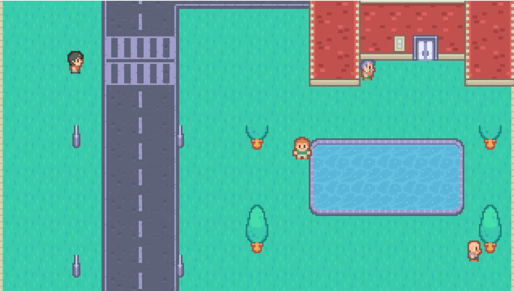
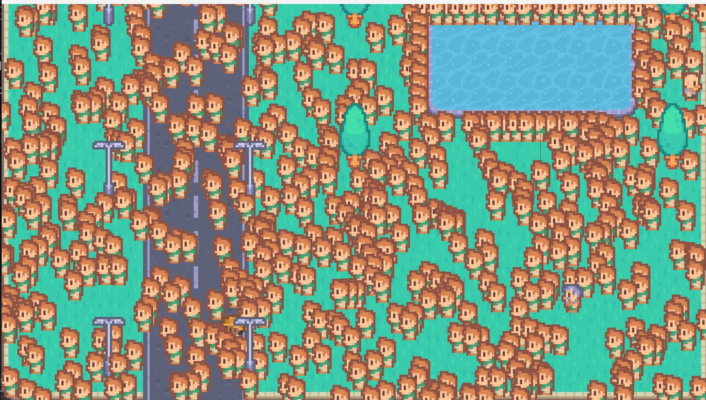

# 2026-10-18
2026-10-24: 지난 주 일지 작성을 하지 않아 작성
## 작업 내용
- `Application::Update()`
   - 주석 정리
	   - 시간 측정 시작과 끝으로 보이는 주석을 이전에 달아두었는데, 실제 측정은 `Run()`에서 있었음
	   - 측정 로직 최초 고려 시 해당 부분에 넣을 생각이었는데, 그때 주석만 써 두고 안 지운 것
	   - 혼동을 야기하는 주석이므로 제거
   - `chore` 커밋
	   - 단순 정리
```C++
void Application::Update(float dt) {
    cullRect.left = camPos.x - halfW - padding;
    cullRect.right = camPos.x + halfW + padding;
    cullRect.top = camPos.y - halfH - padding;
    cullRect.bottom = camPos.y + halfH + padding;
    
    fsmSystem.Update(registry, dt, targetVelocity);
    // 주석 삭제 위치 1
    activatedEntities = physicsSystem->FixedUpdate(registry, dt, cullRect);
    // 주석 삭제 위치 2
}
```

- `EntityManager::CreateEntity()` 상한 검사
	- 검사 위치
		- 새 ID를 발급하는 분기(`entityCounter++`)의 앞
		- 재활용 시 검사하지 않음 (재활용 = 이미 있던 번호 사용 -> 자리가 있음 = 상한 도달 X)
	- 상수 `INVALID_ENTITY` 추가
		- 생성 실패 엔티티를 나타내는 상수
		- `Entity` 타입 (`uint32_t`)
			- `Entity`의 최대값
			- `CreateEntity()` 실패 시 반환 가능해야 함
			- 상수 자체가 실패한 `Entity`를 가리킴
			- 정상 `Entity`와 비교 가능해야 함
	- 상수 `MAX_ENTITIES` 타입 변경
		- `int` -> `Entity`
		- `INVALID_ENTITY`, 정상 `Entity`와 비교 가능해야 함
	- `SpawnBeing()` 실패 처리
		- `CreateEntity()`의 실패, `INVALID_ENTITY`를 그대로 반환
	- `InitEntities()` 상한 처리
		- 맵 기반 생성 루프
			- 정상 생성 시 루프 진행
			- 생성 실패 시 에러 수집 및 다음 루프로 넘어감
			- 실패한 `Entity`가 몇 번째인지, 누구인지 전부 알아야 함
		- 더미 생성 루프
			- 생성 실패 즉시 루프 종료
			- 더미는 몇 번째에서 실패해도 똑같은 더미
			- 몇 번째에서 실패했는지 정보만 알면 될 것이라고 판단
		- 에러 처리
			- 생성 중 에러가 있었다면 콘솔에 출력
			- `return false`하지 않음
				- 상한 초과를 로드 중단이 아니라 **경고로 보고**, 만들 수 있는 것은 만들고 계속 진행
	- 호출부에서 `IsFull()`로 확인하기 (기각)
		- `CreateEntity()`의 판단을 복제하게 됨
			- 한 사실은 한 곳에만 작성 원칙을 세움
			- 수정 시 한 쪽에 반영하지 않을 가능성 고려
			- 해당 검사는 생성 시 외에는 진행하지 않을 것으로 판단
	- `fix` 커밋
		- `MAX_ENTITIES`를 지정하였으나 실제 검사 없었던 오류를 수정


## 검증

| 조건               | 결과                                              |
| ---------------- | ----------------------------------------------- |
| 상한 15, 더미 10     | 플레이어 생성까지 실패. 에러 목록이 `[Fatal Error]`보다 먼저 출력    |
| 상한 20, 더미 10     | 맵 실패 11건. 나무 윗부분, 가로등 윗부분, 일부 NPC, 쓰레기통이 생성 실패함 |
| 상한 1000, 더미 2000 | 970번째 더미에서 실패, 예측과 일치함                          |
 - 테스트 맵에는 기본적으로 31개의 `Entity` 존재
 - 더미 수는 `engine_config.ini`를 통해 조절
 - 3회 모두 `entityCounter`가 상한에서 멈춤
 - 예측이 빗나간 부분
	 - 요청 수는 `Being` 31개 + 더미 10 = 41개가 될 것으로 예상했으나, `spawnPoint`가 31개가 아닌 27개였기 때문에 실제 요청 수는 `spawnPoint` 기반 생성 `Being` 27 + 더미 10 = 37이었음

해당 출력 중 "생성 요청 : x/y 중 z개 생성"은 임시 출력으로, 현재 커밋 코드에서는 지운 상태.
- 상한 15, 더미 10
	- 플레이어 생성 실패로 인해 인게임 진입 실패
```cmd
[Application::InitEntities()] 생성 요청: 37/15중 15개 생성
[Application::InitEntities() 실행 중 에러]
map 기반 생성 중 상한 초과: streetlight_bottom 생성 시도
[Application::InitEntities() 실행 중 에러]
map 기반 생성 중 상한 초과: player 생성 시도
[Application::InitEntities() 실행 중 에러]
map 기반 생성 중 상한 초과: bald_1 생성 시도
[Application::InitEntities() 실행 중 에러]
map 기반 생성 중 상한 초과: tree_top 생성 시도
[Application::InitEntities() 실행 중 에러]
map 기반 생성 중 상한 초과: tree_top 생성 시도
[Application::InitEntities() 실행 중 에러]
map 기반 생성 중 상한 초과: tree_top 생성 시도
[Application::InitEntities() 실행 중 에러]
map 기반 생성 중 상한 초과: tree_top 생성 시도
[Application::InitEntities() 실행 중 에러]
map 기반 생성 중 상한 초과: streetlight_top 생성 시도
[Application::InitEntities() 실행 중 에러]
map 기반 생성 중 상한 초과: streetlight_top 생성 시도
[Application::InitEntities() 실행 중 에러]
map 기반 생성 중 상한 초과: streetlight_top 생성 시도
[Application::InitEntities() 실행 중 에러]
map 기반 생성 중 상한 초과: streetlight_top 생성 시도
[Application::InitEntities() 실행 중 에러]
map 기반 생성 중 상한 초과: streetlight_top 생성 시도
[Application::InitEntities() 실행 중 에러]
map 기반 생성 중 상한 초과: streetlight_top 생성 시도
[Application::InitEntities() 실행 중 에러]
map 기반 생성 중 상한 초과: bin 생성 시도
[Application::InitEntities() 실행 중 에러]
map 기반 생성 중 상한 초과: laborer_1 생성 시도
[Application::InitEntities() 실행 중 에러]
map 기반 생성 중 상한 초과: oldman_2 생성 시도
[Application::InitEntities() 실행 중 에러]
dummy 생성 중 상한 초과: 1번째 dummy 생성 시도
[Fatal Error] 플레이어가 월드에 스폰되지 않았습니다!
엔진 초기화에 실패하여 게임을 종료합니다.
```

- 상한 20, 더미 10
	- 나무 상단, 가로등 상단 일부, 쓰레기통, 일부 NPC 생성 실패

```cmd
[Application::InitEntities()] 생성 요청: 37/20중 20개 생성
[Application::InitEntities() 실행 중 에러]
map 기반 생성 중 상한 초과: tree_top 생성 시도
[Application::InitEntities() 실행 중 에러]
map 기반 생성 중 상한 초과: tree_top 생성 시도
[Application::InitEntities() 실행 중 에러]
map 기반 생성 중 상한 초과: streetlight_top 생성 시도
[Application::InitEntities() 실행 중 에러]
map 기반 생성 중 상한 초과: streetlight_top 생성 시도
[Application::InitEntities() 실행 중 에러]
map 기반 생성 중 상한 초과: streetlight_top 생성 시도
[Application::InitEntities() 실행 중 에러]
map 기반 생성 중 상한 초과: streetlight_top 생성 시도
[Application::InitEntities() 실행 중 에러]
map 기반 생성 중 상한 초과: streetlight_top 생성 시도
[Application::InitEntities() 실행 중 에러]
map 기반 생성 중 상한 초과: streetlight_top 생성 시도
[Application::InitEntities() 실행 중 에러]
map 기반 생성 중 상한 초과: bin 생성 시도
[Application::InitEntities() 실행 중 에러]
map 기반 생성 중 상한 초과: laborer_1 생성 시도
[Application::InitEntities() 실행 중 에러]
map 기반 생성 중 상한 초과: oldman_2 생성 시도
[Application::InitEntities() 실행 중 에러]
dummy 생성 중 상한 초과: 1번째 dummy 생성 시도
```

- 상한 1000, 더미 2000
	- 더미 생성 최초 실패는 970번째
	- 1000-31 = 969번째 더미까지는 생성됨

```cmd
[Application::InitEntities()] 생성 요청: 2027/1000중 1000개 생성
[Application::InitEntities() 실행 중 에러]
dummy 생성 중 상한 초과: 970번째 dummy 생성 시도
```
## 발견
- 요청 생성 수(27)와 실제 생성 수(31)의 차이(4)는 `RenderParser::LoadMapJSON()`에서 만들어지는 벽 엔티티였음
- `CreateEntity()`를 호출하나, 실패 확인은 `InitEntities`에만 추가
	- 지금 설정(상한 5000, 벽이 가장 먼저 생성됨)에서는 이 경로가 실패하지 않음
	- 현재 벽 생성 경로에서는 실패 확인을 하지 않아 `INVALID_ENTITY`에 접근하여 범위 밖 접근을 할 수 있음
- 벽은 `Being`이 아닌, 벽 레이어에 의해 생성된 `Entity`
## 요확인
- `DestroyEntity()`
	- 받은 ID가 유효한지 검사하지 않음
	- 같은 ID를 2번 삭제하면 같은 ID가 2번 발급되어 크래시 없이 데이터가 조용히 망가질 여지가 있음
	- `activeEntityCount`가 0 아래로 내려갈 수 있음
	- `signatures`만으로는 살아있는 엔티티와 삭제된 엔티티를 구분할 방법이 없음
- `EntityManager` public 멤버 변수
	- 캡슐화 필요
- config 열 이름, 필드 이름 대소문자 불일치
	- 차후 수정
- 히스토리성 주석 삭제 필요
- `GetEntityCapacity()` 이름
	- `Capacity`를 얻는다는 이름과는 다르게, ID가 발급된 횟수인 `entityCounter`를 반환
	- 살아 있는 수는 `activeEntityCount`임
	- 위 둘을 헷갈리게 하기 때문에 이름 수정이 필요함
- 매직 넘버 처리
	- `SpawnBeing()`, `InitEntities()`에서의 매직 넘버 및 `char timeStr[26]`
	- 벽 생성 경로의 매직 넘버
- vcxproj BOM

## AI에게 받은 도움
- 코드 구상 시 도움
	- `vector`의 `[]`로 범위 밖을 접근하면 정의되지 않은 동작이 된다는 것
	- 같은 ID를 두 번 `Destroy`할 경우 생길 문제가 있음을 짚어줌
	- 큐 안의 ID가 상한을 넘지 않는 이유를 인과로 이어 설명
- 코드 리뷰 지적
	- `IsFull()` 구현이 판단을 복제하기 때문에 기각된 것
	- 검사를 `entityCounter++` 뒤에 둔 것
	- `unordered_map`의 키가 전부 같은 값이 되는 문제
	- 모은 에러를 출력하지 않던 것
	- 출력 순서
	- `signatures.size()`를 요청 수로 쓴 것
	- `spawnRequested`가 항상 0이던 것
- 커밋 타입 규칙, `git add -p` 사용법
- 커밋 메시지 및 일지 피드백

## 직접 한 것
- 두 루프의 처리 방식 결정 및 근거
- `MAX_ENTITIES` 타입을 정의 쪽에서 맞춘 판단
- 시나리오별 예상값 작성 및 실측 비교
- 벽 생성이 별도 함수(`LoadMapJSON`)에서 이뤄지기 때문임을 코드 및 맵 json 파일을 열어 알아냄
- diff 검토
- 커밋 메시지 작성